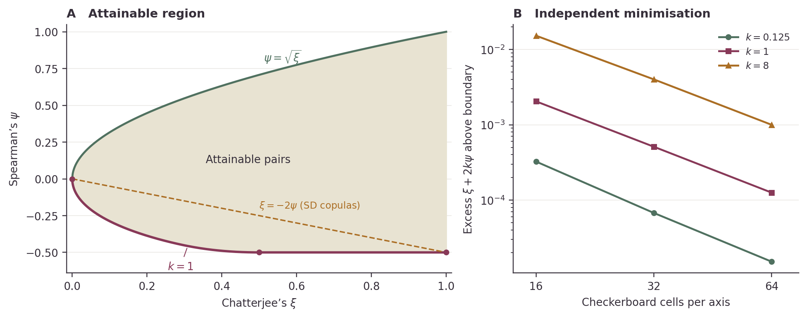

## Summary

**In one sentence.** When the rankings of two continuous quantities are pushed apart by a given amount, this paper finds exactly how small Chatterjee's measure of functional dependence can be, the one joint law that reaches that minimum, and a certificate that nothing does better, which completes the map of possible value pairs begun by Rockel.

**The question.** When analysts look at two measured quantities $X$ and $Y$, they often report more than one summary of how the two depend on each other. Two rank-based summaries are compared here.

- *Chatterjee's coefficient* $\xi$ asks "how far is $Y$ a function of $X$?". It is $0$ under independence and $1$ when $Y$ is exactly a function of $X$, whatever the shape of that function. It was introduced by Chatterjee (2021) and is now widely used; its population version is due to Dette, Siburg and Stoimenov.
- *Spearman's footrule* $\psi$ asks "how close are the two rankings?". With $U$ and $V$ the ranks scaled to $[0,1]$, $\psi=1-3\,\mathbb E|U-V|$. It is $1$ for identical rankings, $0$ under independence, and $-1/2$ when the rankings are as far apart as possible.

Which combinations of the two numbers can actually occur together? This set of pairs $(\xi,\psi)$ is the *exact region*. Knowing it turns into sharp inequalities between the two summaries; a reported pair outside it is impossible.

**What was known.** Rockel (2026) found most of the region: the upper edge $\psi=\sqrt\xi$, the corner at footrule $-1/2$ (where the least $\xi$ is $1/2$, reached only by a checkerboard copula), the region for "stochastically increasing" data, and the inequality $|\psi|\le\sqrt\xi$ for every copula. He also showed that the region is convex and closed. The curved lower edge stayed open: for a footrule between $-1/2$ and $0$, how small can $\xi$ be? He gave a lower bound and a family of examples that was already numerically close.

**What is new.**

| Result | In plain terms | Where |
|---|---|---|
| The exact lower edge | For every footrule strictly between $-1/2$ and $0$, the least possible $\xi$, the one and only copula that attains it, and a proof certificate valid for all copulas; nearly optimal copulas are close to the extremiser | Theorem 1 |
| A simple recipe | The response takes one of two levels, depending on whether the predictor's rank lies below a threshold; the threshold solves a linear integral equation with a triangular kernel | Sections 2–4 |
| Concrete values | $\xi+2\psi\ge-0.6042071\ldots$ for every copula; at $\psi=-0.3$ the least $\xi$ is about $0.110$, against $0.097$ from the earlier lower bound; closed form for $\psi\le-0.4565\ldots$ | Proposition 3, Table 1 |
| Restricted classes | Every possible pair has a radially symmetric representative. Under positive or negative quadrant dependence the regions are determined; at zero footrule $\xi$ can approach, but never reach, $1/2$ and $3/4$ respectively | Section 7 |
| Stochastically decreasing data | The lower edge is the same curve, zero footrule forces independence, and every pair between the curve and the line $\xi=-2\psi$ is attained; that this line is the upper edge is a **conjecture**, not a theorem | Proposition 8, Conjecture 9 |
| Beyond ranks | The construction extends to variables with non-uniform distributions and to several displacement terms | Section 8 |



**Credit.** The upper edge, the corner at $-1/2$, the stochastically increasing region, convexity and closedness, the fact that each lower-edge point is attained by a stochastically decreasing copula, the inequality $|\psi|\le\sqrt\xi$, the Jensen lower bound and the near-optimal two-parameter family are Rockel's. The radial and quadrant results parallel those of Orenday Lares and Rockel for Chatterjee's $\xi$ and Blomqvist's $\beta$; the contrast is that for the footrule the zero sections shrink to $[0,1/2)$ and $[0,3/4)$. Ansari and Rockel used an optimal-transport dual construction for Spearman's rho and the footrule. The Bertino copula is from Fredricks and Nelsen.

**Idea of the proof.** The coefficient $\xi$ is quadratic in the conditional distribution functions, which makes direct optimisation awkward. Written through conditional quantiles it becomes linear: minimising $\xi+2k\psi$ is the same as maximising $\mathbb E\{TV+k(V-U)_+\}$ over couplings of a uniform square $(U,T)$ with a uniform target $V$. The payoff is the larger of two straight pieces, which gives a supporting-line (dual) certificate, and asking the output to be uniform gives the integral equation for the threshold.

**Limits.** The results concern population coefficients of continuous variables, not sample estimates. The closed form covers only $\psi\le-0.4565\ldots$; elsewhere the boundary is a finite numerical calculation, and the table values are double-precision computations cross-checked by independent methods, not interval-certified bounds. Rockel's earlier family was already numerically close (for $\xi+\psi$ it gives $-0.193$ to three decimals; the exact minimum is $-0.1932281\ldots$), so the advance is exactness, uniqueness, the proof of optimality and stability. The stochastically decreasing upper edge is a conjecture supported by numerical search. This is an unrefereed candidate; its assurance is internal AI-assisted review and computational checks only.

## Summary for specialists

Let $C$ be a copula, $h_C(u,v)=\Pr(V\le v\mid U=u)$, $\xi(C)=6\iint(h_C-v)^2$ and $\psi(C)=1-3\,\mathbb E|U-V|$. For $k>0$ let $K_k$ be the integral operator on $[0,1]$ with the triangular kernel $(1-|z-t|/k)_+$, let $b_k(t)$ be the average of $\min(1,\max(0,s))$ over $s\in[t,t+k]$, and put $r_k=(I+K_k)^{-1}b_k$. With independent uniforms $U,T$ and the slope distribution function $A_k$,

$$V_k=A_k\big(T+k\,\mathbf 1_{\{U<r_k(T)\}}\big),$$

$$C_k=\mathrm{Law}(U,V_k).$$

- **Theorem 1** *(proof)*: $C_k$ is the unique minimiser of $\xi+2k\psi$ over all copulas; $(x_k,y_k)=(\xi(C_k),\psi(C_k))$ is given by explicit integrals; as $k$ runs over $(0,\infty)$, $y_k$ decreases strictly from $0$ to $-1/2$ and $x_k$ increases strictly from $0$ to $1/2$. For $-1/2<y<0$ the least $\xi$ is $m(y)=x_k$ with $y_k=y$, attained only by $C_k$, which is stochastically decreasing. For every copula $C$ the excess

$$\xi(C)+2k\psi(C)-x_k-2ky_k$$

  is at least $6\,\|h_C-h_{C_k}\|_{L^2}^2$.

- **Proposition 3** *(proof)*: for $k\ge1$, with $d=\sqrt{2/k}$ and $D=\cosh(d/2)$, $r_k(t)=\tfrac12+d\sinh(d(t-\tfrac12))/(4D)$ and $(x_k,y_k)$ are elementary; for $0<k<1$, $r_k$ is a finite combination of exponentials from a nonsingular linear system. Near independence $\psi=-\sqrt\xi+\xi/4+O(\xi^{3/2})$; near the checkerboard $\psi=-\tfrac12+(\tfrac12-\xi)^2+O((\tfrac12-\xi)^3)$. At $k=1$: $\xi+2\psi\ge-0.6042071213\ldots$, with $x_1=0.3088802920\ldots$ and $y_1=-0.4565437066\ldots$.
- **Corollary 4, Lemma 5, Theorem 6, Proposition 7** *(proof)*: radially symmetric representatives for every pair (NQD for $y<0$, PQD for $y>0$); PQD or NQD with $\psi=0$ forces $C(u,u)=u^2$ and $2\xi+\rho\le1$; the PQD region is $\{0<y\le1,\ y^2\le x\le1\}\cup\{(x,0):0\le x<1/2\}$; under NQD at $\psi=0$ the attainable $\xi$ are exactly $[0,3/4)$.
- **Proposition 8** *(proof)* and **Conjecture 9** *(not proved)*: SD copulas have $\psi\le0$ with equality only for $\Pi$; their lower edge is $m$; the block family $B_l$ has $\xi=1-l^2$, $\psi=-(1-l^2)/2$; every pair with $m(y)\le x\le-2y$ is attained by a radial SD copula. Conjecture: every SD copula has $\xi\le-2\psi$.
- **Theorems 10 and 11** *(proof)*: unique maximisers of $\mathbb E|Y-Y'|+2k\,\mathbb E|X-Y|$ for nonuniform margins and of payoffs with several absolute-displacement terms.

**Known and new.** Rockel (JCAM 485, 117466) left the minimisation of $\xi+\mu\psi$ open (his eq. (16)); the open arc $0<x<1/2$, $-1/2<y<0$, its unique extremisers, the certificate and the stability estimate are new within the searched literature. The transport theory from several dimensions to one (Chiappori, McCann and Pass) assumes smoothness this payoff lacks; duality for costs depending on conditional laws goes back to Gozlan, Roberto, Samson and Tetali. Neither the triangular kernel nor the supporting-line inequality is new as an object; their combination into an exact solution of this problem is.

## Technical account

**Conditional quantiles make the objective linear.** If $Q(u,\cdot)$ is the conditional quantile function of $C$ and $T$ is uniform and independent of $U$, then $V=Q(U,T)$ has law $C$, and a second draw $V'=Q(U,T')$ gives $\xi(C)=1-3\,\mathbb E|V-V'|$. Because $Q(u,\cdot)$ is nondecreasing,

$$\xi(C)=6\,\mathbb E(V-T)^2,$$

$$\xi+2k\psi=4+2k-12\,J,$$

where $J=\mathbb E\{TV+k(V-U)_+\}$.

So the problem becomes a transport problem from the square $(U,T)$ to the uniform interval $V$; a relaxed maximiser that is nondecreasing in $T$ is a conditional quantile and solves the copula problem (Section 3).

**The supporting-line certificate.** For a nondecreasing $A$ with primitive $H$ and convex conjugate $H^*$, the payoff $tv+k(v-u)_+=\max\{tv,(t+k)v-ku\}$ minus $H^*(v)$ is at most $\max\{H(t),H(t+k)-ku\}$, with equality at $v=A(t)$ or $v=A(t+k)$ (Lemma 2). Choosing the branch by the threshold $r(t)=(H(t+k)-H(t))/k$ attains the bound.

**The threshold equation.** Asking the output to be uniform is the linear equation $r+K_kr=b_k$ (Section 4). The map $r\mapsto b_k-K_kr$ is a contraction with constant $k$ for $k\le1/2$ and $1-1/(4k)$ for $k\ge1/2$, so successive substitution converges geometrically. Uniqueness and the stability estimate follow because $\xi$ is a quadratic in the mixing weight with leading coefficient $6\|h_C-h_{C_k}\|^2$.

**Tracing the edge and evaluating it.** The threshold is continuous, increasing and symmetric, $r(t)=1-r(1-t)$; different multipliers give different copulas, and comparing objectives gives the strict monotonicity of $(x_k,y_k)$ (Section 5). Differentiating twice gives $kr''(t)=2r(t)-r(t-k)-r(t+k)$, which for $k\ge1$ is $kr''=2r-1$ and gives the hyperbolic closed form; for $k<1$ the equation splits into finitely many linear systems with exponential solutions (Section 6).

**Restricted classes.** Lemma 5 splits the conditional law at the diagonal and gives $\xi=\tfrac12(1-\rho)-3\,\mathbb E R(U)$ at zero footrule, which bounds $\xi$ by $1/2$ under PQD (where $\rho>0$ unless independent) and by $3/4$ under NQD (where $\rho\ge-1/2$, the Bertino value). Strip copulas with $\xi=(1-1/n)^2/2$ and purified Bertino couplings approach the two suprema (Section 7).

## Evidence, assurance and limitations

The synthetic audio briefing is explanatory, not additional evidence. Its [complete transcript](/assets/audio/chatterjee-footrule-lower-boundary.txt) is available for reading.

- **Proofs.** Every theorem has a written proof in the 17-page paper, which opens with a plain introduction (the question, what was known, what is new, the method and a roadmap) and ends with limits, open problems and an AI-use statement. No proof assistant was used.
- **Three evaluations of the boundary.** The closed form, the finite-mode system and a midpoint Nyström solver with 4,096 panels agree: at $k=1$ the first two differ by $3\times10^{-16}$, and at seven multipliers from $1/8$ to $8$ the midpoint solver is within $6\times10^{-8}$ of the exact evaluation. Table 1 is computed from the exact evaluations.
- **Independent minimisation.** The original objective was minimised separately over checkerboard copulas on $16\times16$, $32\times32$ and $64\times64$ grids, with an assignment-based optimality gap below $4\times10^{-10}$. Every grid value lies above the continuum value, and the excess falls about fourfold per doubling (at $k=1$: $0.002044$, $0.000510$, $0.000125$). This is a consistency check; the certificate is Lemma 2.
- **Conjecture 9 evidence.** A local vertex search over stochastically decreasing checkerboard copulas on grids of size 10, 16 and 24, from independence and 40 seeded random starts, found no positive value of $\xi+\lambda\psi$ for $\lambda\ge2$ (largest $1.3\times10^{-15}$). This is evidence, not proof.
- **Tests that can fail.** Every check raises an error on failure (no `assert`), and `run_all.sh` runs them in Python's optimised mode. Changing the expected value of $\xi(B_l)$ from $1-l^2$ to $1-l^2/2$ makes the table script fail.
- **Replay.** `run_all.sh` was rerun from a fresh copy before release with the pinned packages (CPython 3.12.11, NumPy 2.3.5, SciPy 1.17.0); all five result files matched the recorded ones byte for byte. GitHub CI reruns everything on Linux and compares numbers within a declared tolerance (largest observed difference $4\times10^{-13}$), and repeats the failure test.
- **Review.** Five internal reviewer roles (editor, methodology, domain, perspective and devil's advocate) ran as one combined Claude pass and recomputed the curve independently. The revision credited the published version of Rockel's paper and its inequality, added Table 1 and the comparison with Orenday Lares and Rockel, reframed what kind of answer the paper gives, rebuilt the introduction, expanded three compressed proof steps, made every check fail loudly, and added the stochastically decreasing results. A verification re-review and a proof audit of the new and rewritten proofs found no mathematical error; their required items (two script defects, two citation fixes, small proof gaps) were applied. No second-model review took place for this release. A rating-free summary is in the package. None of this is peer review, independent reproduction or formal verification.
- **Limitations.** Population coefficients only; closed form only for $\psi\le-0.4565\ldots$; table values cross-checked but not interval-certified; Conjecture 9 and the inequality $\xi\ge\psi^2+|\psi|^3/2$ (suggested by a numerical observation) are not proved. Attributions rest on a literature search of limited scope. This remains an unrefereed candidate.

## Who should care, and why

| Audience | Potential use | Required caution |
|---|---|---|
| Statisticians reporting Chatterjee's coefficient with the footrule | Check whether a pair of values is possible at all, and read off the sharp lower limit on functional dependence for a given negative footrule (Table 1) | Population coefficients; sample estimates need sampling error accounted for |
| Researchers on dependence measures and copulas | The completed region, unique extremisers, a stability estimate and the restricted-class regions | The stochastically decreasing upper edge is a conjecture |
| Optimal-transport researchers | An exactly solved transport problem from two dimensions to one with a kinked payoff, and its extensions | Existence for nonuniform margins is by compactness; the iteration converges only under the stated contraction conditions |
| Research agents | Machine-readable claims, an agent index and replayable scripts with a failure test | The computations check formulae; the proofs carry the theorems |

## Why the problem matters

Chatterjee's coefficient is increasingly reported alongside classical rank correlations, because it detects dependence of any shape. Exact regions say what the different summaries jointly allow, so they turn a pair of reported numbers into a checkable statement, and they show which dependence structures sit at the extremes. This edge was the last missing piece of the region for the footrule.

## How to inspect or reproduce the recorded checks

From the GitHub release or the Zenodo archive, from the package root, with Python 3.12 and the pinned packages (about a minute):

```sh
shasum -a 256 -c MANIFEST.sha256
PYTHON="uv run --python 3.12 --with numpy==2.3.5 --with scipy==1.17.0 --with matplotlib==3.10.8 python3" sh code/run_all.sh
```

`run_all.sh` overwrites `results/` and `figures/`, so run it in a copy and compare with `python3 -I .github/ci/compare_output.py <copy>/results results`. `ENVIRONMENT.txt` records the software used and the comparison policy. `AI_INDEX.md` maps each claim to its proof and checks, `RESEARCH_GATES.json` records the prior-work boundary and the sources read, and `REVIEW_SUMMARY.md` lists the review objections and how each was handled.

## The most valuable next projects

1. Prove or refute Conjecture 9, which would complete the region for stochastically decreasing copulas.
2. Certify Table 1 with interval arithmetic on the finite-mode system.
3. Prove the clean inequality $\xi\ge\psi^2+|\psi|^3/2$ for $\psi\le0$ suggested by the computed curve, and study how the bounds transfer to sample estimates.

## What is in the evidence package

The paper (LaTeX source `manuscript.tex`, the PDF and Figure 1); the scripts in `code/` with the driver `run_all.sh` and their recorded outputs in `results/`; `requirements.txt` with the pinned packages; `refs.bib` from Crossref and arXiv records; `AI_INDEX.md`; `REVIEW_SUMMARY.md`; `RESEARCH_GATES.json`; `REPLAY_RECEIPT.md` and `ENVIRONMENT.txt`; citation metadata, licences (CC0-1.0 for text, MIT for code), the CI workflow with its comparison script, and SHA-256 sums.
