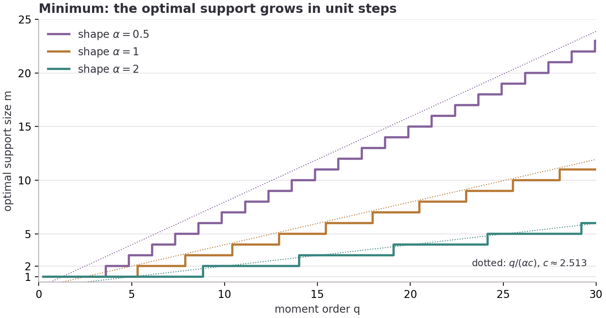

## Summary

*How to read this page.* The Summary is in plain English and is enough for most readers. Specialists can go straight to the exact statements in the next section; the Technical account explains how the proofs work. Evidence, limits, credit and the route to rerun the checks follow.

**The question.** Take several independent random waiting times, for example the time until each of several machines next fails, each exponentially distributed with mean one. Form a weighted total, $S=a_1X_1+\dots+a_nX_n$, with nonnegative weights. Fix the *variance* of the total, which here means requiring the squared weights to add up to one. How small, and how large, can the average of $S^q$ (the $q$-th moment) be?

**Why this is not obvious: a tug-of-war.** If the *mean* were fixed instead, the answer would be routine: spreading the weight evenly makes the total less variable, so every convex moment is smallest with equal weights and largest with all the weight on one variable. Fixing the variance changes the contest.

- *Concentrating* all the weight on one variable keeps the mean of $S$ small (it is $1$, against $\sqrt n$ for equal weights), but leaves that variable's heavy tail intact.
- *Spreading* the weight thins the tail but raises the mean.

Low moments are dominated by the mean, so they prefer concentration; high moments are dominated by the tail, so they prefer spreading. Where exactly does one win over the other?

**The answer for the minimum: a staircase.** The best weights are always some number $m$ of equal weights with the rest zero. For exponential waiting times:

| Moment order $q$ | Best weights |
|---|---|
| up to $5.3197\ldots$ | all weight on one variable |
| $5.32$ to $7.88$ | two equal weights |
| $7.88$ to $10.41$ | three equal weights |
| $10.41$ to $12.93$ | four equal weights |
| beyond | one more at each step, roughly $0.40\,q$ in the long run |

Brazitikos and Pandis conjectured this rule for every real $q$ (their Conjecture 4.8). It was previously known for whole-number $q$, for $q\le4$, and, in an AI-generated dossier, for $q\le5$. **This paper proves it for every real $q>0$**, and for gamma variables of any common shape $\alpha$ (exponential is $\alpha=1$), with all the cases of equality.



**The answer for the maximum: flat, then a jump.** The paper also finds the largest moment, which had not been settled for real $q$. Equal weights on all $n$ variables are best up to a switch point $q^*$; beyond it the best vector has one larger weight and all the others equal. With two variables the change is gradual. With three or more it is abrupt: the best weights jump. For three exponential variables the switch is at $q^*\approx4.85$ (a numerical value). A practical consequence: in a window of $q$ just above $q^*$, the equal-weight vector passes every local test for a maximum and yet is not the maximum, so a local search started there stops at the wrong answer.

**Where it applies.** Gamma shape $\alpha=1/2$ covers positive weighted sums of squared Gaussians (chi-square type quadratic forms): for example, at $q=4$ the smallest fourth moment, $96$, comes from rank two, not rank one ($105$). Shape $\alpha=1$ also covers averages over the simplex (Dirichlet laws).

## Summary for specialists

Let $X_1,\dots,X_n$ be independent $\mathrm{Gamma}(\alpha,1)$, $S=\sum_ia_iX_i$ with $a_i\ge0$ and $\sum_ia_i^2=1$, and

$$
\rho_\alpha(m,q)=\frac{\Gamma(m\alpha+q)}{\Gamma(m\alpha)\,m^{q/2}},
$$

the value of $\mathbb ES^q$ at the flat vector with $m$ entries $m^{-1/2}$.

| Result | Content | Status |
|---|---|---|
| Theorem 1 | For every $n$, $\alpha>0$, real $q>0$: $\min\mathbb ES^q=\min_{1\le m\le n}\rho_\alpha(m,q)$, attained exactly at permutations of flat vectors with a minimising support size $m$. For $\alpha=1$ this is Brazitikos–Pandis Conjecture 4.8 | Proof |
| Section 3 | Critical points take at most two positive values; for a minimiser the smaller value occurs only once (second-order argument, real $q$, all $\alpha$) | Proof |
| Lemma 2 | Exact sign formula on the one-small-coordinate curve via the Gauss hypergeometric equation: no interior local minimum for $q>2$ | Proof |
| Section 5, (18)–(19) | Curvature at flat vectors; a flat support of size $m\ge2$ can be minimal only if $q>m\alpha+2$ | Proof |
| Section 6, Proposition 4 | Optimal support size increases in unit steps; $m_q\sim q/(\alpha c)$ with $\log(1+c)=c/2$, $c=2.5128\ldots$ | Proof |
| Theorem 3 | Maximum at the flat vector or at $(x,1,\dots,1)/\sqrt{x^2+n-1}$, $x>1$, located by the unique interior local maximum of an explicit hypergeometric function; flat is the unique maximiser for $q<q^*$ and not a maximiser for $q>q^*$; $n=2$: $q^*=2\alpha+2$, continuous; $n\ge3$: $2+2\alpha\sqrt{n-1}<q^*<n\alpha+2$, jump | Proof; values of $q^*$ numerical |
| Proposition 5 | Negative exponents $-n\alpha<q<0$: flat vector the unique minimiser; maximum at coordinate vectors, with the integrability criterion | Proof |
| Section 7 | Dimension-free constants; positive Gaussian quadratic forms ($\alpha=1/2$); symmetric Dirichlet averages | Corollaries |

## Technical account

**Two values at most (Section 3.1).** Gamma size bias, $\mathbb E[X\Phi(X)]=\alpha\,\mathbb E\Phi(X+E)$ with $E$ an independent standard exponential, turns the Lagrange condition into $\partial_iF=q\alpha a_i\mathbb E(S+a_iE)^{q-1}$ and, by a difference identity, into a monotone function of $a_i$ evaluated with two fresh exponentials. Three distinct positive values would force a strictly convex function to take one value three times, so any critical point has at most two positive coefficient values. This step is the size-bias machinery of Brazitikos, Tang and Tkocz, extended to all $\alpha$.

**The smaller value occurs once (Section 3.2).** If two coordinates share the smaller value, the second variation in the direction that separates them is negative, (10), so the point is not a minimiser. A non-flat minimiser therefore has one smaller coordinate and $r$ equal larger ones.

**Excluding the last configuration (Section 4).** Along the curve $(x,1,\dots,1)/\sqrt{x^2+r}$ the moment is a Gauss hypergeometric function of $x$. Substituting into its differential equation gives an exact sign formula, (16), in which every factor of the integrand is positive except a quadratic $P$. The sign pattern of $P$ shows the moment has no interior local minimum on $(0,1)$ for $q>2$ (Lemma 2). Hence every minimiser is flat on its support, and comparing flat supports gives Theorem 1.

**The staircase (Section 6).** The continuous extension of $m\mapsto\log\rho_\alpha(m,q)$ is unimodal; the transitions $q_{m,\alpha}$ at which supports $m$ and $m+1$ tie are increasing, so the optimal support grows by exactly one at each step. Digamma and Stirling bounds give the large-$q$ rate (Proposition 4).

**The maximum (Section 8).** The same two-value reduction applies to maximisers, but now the larger value occurs once. Lemma 6, the analogue of Lemma 2 for $x>1$, shows the hypergeometric curve has at most one interior local maximum. Comparing it with the flat value gives the switch $q^*$; log-convexity in $q$ makes the set of $q$ where the flat vector wins an interval. For $n=2$ the interior maximum emerges from the flat point continuously at $q=2\alpha+2$; for $n\ge3$ it appears at a distance, so the maximiser jumps.

**Classical and new.** The size-bias identity, the critical-point identity and the integer-$q$ results are from Brazitikos–Pandis and Brazitikos–Tang–Tkocz; log-concavity of moments is Borell's; the location of both extremes for negative exponents follows from Chasapis, Singh and Tkocz. New here, as far as a bounded search found: the real-$q$, all-$\alpha$ second-order argument; Lemma 2 and so Theorem 1 with all equality cases; a proof of the curvature formula that contains the dossier's Claim B; the ordering of transitions for real $q$; a complete proof of the asymptotics; the sharp maximum, Theorem 3; and the uniqueness statements of Proposition 5.

## Evidence, assurance and limitations

The synthetic audio briefing is explanatory, not additional evidence. Its [complete transcript](/assets/audio/gamma-sum-sharp-moments.txt) is available for reading.

- **Proofs.** Written out in full in the 18-page paper; not machine-verified.
- **Computer checks.** Four scripts make 26,147 explicit checks: computer algebra for every identity in the proofs (residuals written out), exact rational comparisons near every flat vector for whole-number $q$, 30-digit sign checks of Lemmas 2 and 6 on 262 parameter families, optimisation searches for real $q$, and global maximisation over the sphere for $n\le6$. They are finite checks at sample parameters; they support but do not replace the proofs.
- **Replay.** All checks were rerun from a fresh extraction of the published archive with Python `-I -B` and with `-O` (CPython 3.11.14, NumPy 2.3.5, SciPy 1.17.0, SymPy 1.14.0, mpmath 1.3.0); both passed 26,147 checks, and every recorded value matched the shipped results apart from timings. The scripts use no `assert`, and a deliberately broken copy fails under `-O`. GitHub CI on Linux reruns everything in both modes.
- **Numerical values.** The switch values $q^*$ in Table 2 (for example $4.85$ for three exponentials) come from 30-digit bisection; the theorem asserts only their existence, bounds and behaviour.
- **Not covered.** Unequal shapes, signed weights (the balanced-sign conjecture of Brazitikos, Tang and Tkocz), centred moments and quantitative stability.
- **Review.** Internal AI-assisted review only: five reviewer roles, an adversarial review by a second model, one revision round that added the maximum and the other extensions, a proof audit and a second-model audit of the new proofs, and a re-review. None of this is human peer review, independent reproduction or formal verification.
- **Prior art.** A bounded search (arXiv, Crossref, citations, GitHub issues and code, the Evidence Press corpus, web formula searches) found no earlier proof of Theorem 1 or Theorem 3; this does not certify priority.

## Relationship to earlier work

Credit for the problem and most of the road to it belongs to others.

- **Brazitikos and Pandis** ([arXiv:2512.12254](https://arxiv.org/abs/2512.12254)) posed the real-exponent conjecture (their Conjecture 4.8), proved it for every whole-number $q$ (Theorem 4.5), described the shape of the whole-number maximiser and settled two variables.
- **Brazitikos, Tang and Tkocz** ([arXiv:2602.03058](https://arxiv.org/abs/2602.03058)) proved a Schur-concavity theorem that gives the conjecture for $q\le4$, and supplied the size-bias and critical-point identities used here.
- **A Machina Mathematica dossier** from Korea Superintelligence Labs ([ideosphere.ai](https://ideosphere.ai/papers/brazitikos-realq), September 2026; AI-generated and unrefereed) extended the conjecture to $q\le5$, gave the real-$q$ two-value reduction, stated a curvature claim as a conjecture and left a window of exponents open. This paper proves the curvature claim and closes that window.

## Who should care, and why

| Audience | Potential use | Required caution |
|---|---|---|
| Statisticians and signal-processing or randomised-linear-algebra users | Exact best and worst constants, and the extremal weightings, for moments of weighted chi-square sums or positive Gaussian quadratic forms at fixed variance (Frobenius norm) | Equal shapes and nonnegative weights only |
| Queueing and reliability modellers | Sharp moment bounds for weighted sums of exponential or Erlang stages | Independence and a common shape are assumed |
| Probabilists working on Khinchin-type inequalities | A complete real-exponent answer, a hypergeometric sign method and a minimum–maximum picture to test on other families | Signed coefficients and unequal shapes remain open |
| Optimisation practitioners | A concrete case where a symmetric point passes local tests but is not the global maximum | The window is narrow and explicit |
| Research agents | Claim map, agent index and replayable checks | Checks corroborate; results rest on the written proofs |

## Why the problem matters

Sharp constants in moment comparisons, of the kind Haagerup found for Rademacher sums, are basic tools in probability and its applications, and the extremal vectors often reveal a phase transition. For positive sums the fixed-variance problem had resisted a complete answer because the competition between mean and tail moves the optimum through a whole sequence of shapes. This paper gives the complete answer, both ends, for every exponent and every gamma shape.

## How to inspect or reproduce the recorded checks

From the GitHub release or the Zenodo archive, in the package root:

```sh
shasum -a 256 -c MANIFEST.sha256
uv run --with numpy==2.3.5 --with scipy==1.17.0 --with sympy==1.14.0 --with mpmath --with matplotlib==3.10.8 \
  python3 -I -B run_checks.py --out rerun/normal
uv run --with numpy==2.3.5 --with scipy==1.17.0 --with sympy==1.14.0 --with mpmath --with matplotlib==3.10.8 \
  python3 -O -I -B run_checks.py --out rerun/optimized
```

Each run takes about two minutes on one core and must end with `PASS: 26147 checks passed, 0 failed`. `VERIFICATION.md` says what each check certifies and what it does not, `AI_INDEX.md` gives a machine-oriented claim map, and `PRIOR_ART.md` records the credit and the searches.

## The most valuable next projects

1. Extend Theorems 1 and 3 to unequal gamma shapes, where the size-bias identity no longer combines.
2. Settle the balanced-sign conjecture of Brazitikos, Tang and Tkocz for signed exponential sums.
3. Prove a quantitative stability inequality: how far from optimal is a vector that is far from every minimiser?
4. Certify the switch values $q^*$ with interval arithmetic and describe their growth in $n$.
5. Apply the hypergeometric sign method to other families with a size-bias identity, such as negative binomial or beta sums.

## What is in the evidence package

The 18-page paper (PDF and its Markdown source) with two figures; the prior-art and credit record; a verification ledger saying what each check certifies; four verification scripts and a runner, with the recorded outputs of normal and `-O` runs and a deliberately broken negative-control run; the figure data and tables of constants and transitions; the raw Crossref and arXiv records from which every reference was copied; an agent index and research-gate record. Licences (text, figures and data CC0-1.0; code MIT), citation metadata, CI and SHA-256 sums for every file. This is an unrefereed candidate, released for scrutiny.
