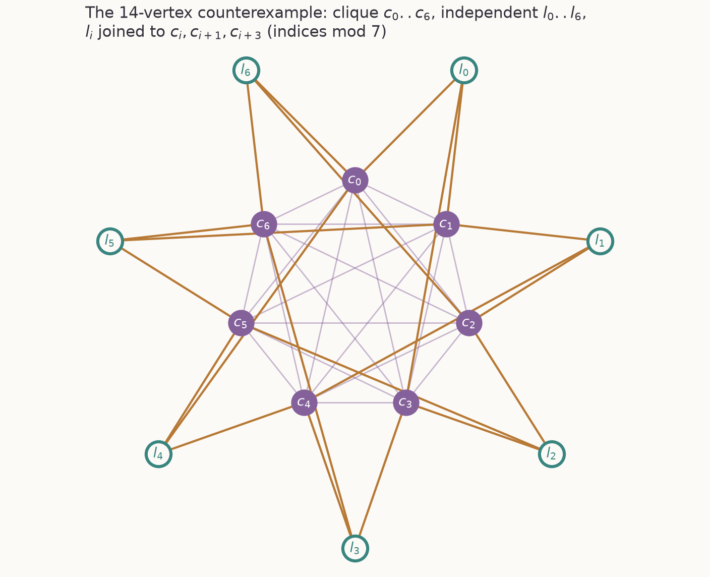
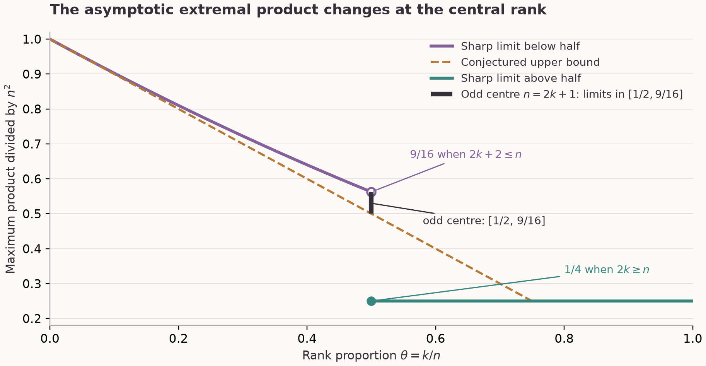

## Summary

*How to read this page.* The Summary is in plain English and is enough for most readers. Specialists can go straight to the exact statements in the next section; the Technical account explains how the proofs work. Evidence, limits, credit and the route to rerun the checks follow.

**Graphs and their complements.** A graph is a set of points (vertices) joined by lines (edges). Its complement has the same points and exactly the missing lines: wherever the graph has an edge, the complement has none, and the other way round. A graph with many edges therefore has a sparse complement, so a graph and its complement cannot both be dense. Results that bound a graph and its complement together are called Nordhaus–Gaddum inequalities.

**What the eigenvalues measure.** Each graph on $n$ vertices has a list of $n$ Laplacian eigenvalues, written in descending order as $\mu_1\ge\mu_2\ge\dots\ge\mu_n=0$. They measure how well connected the graph is at different scales. All of them lie between $0$ and $n$.

**The conjecture.** In 2025 Chen, Guo, Li and Wang asked how large the $k$th eigenvalue of a graph and the $k$th eigenvalue of its complement can be together, measured by their product. They conjectured that the product never exceeds $n(n-k)$, for every rank $k$ up to $3n/4$. They proved this for $k=1$ and for $n/2\le k\le 3n/4$. Whether it held for ranks below $n/2$ was open.

**It is false.** Below $n/2$ the bound can be beaten by a balancing trick. Make about half the vertices a clique (all joined to one another), which pushes up the graph's eigenvalue. Leave the other half independent (no edges among them); in the complement they become a clique, which pushes up the complement's eigenvalue. Then add a carefully balanced set of edges between the two halves, so that both eigenvalues stay high at the same rank.

**The smallest example here has 14 vertices.** Take seven clique vertices and seven independent vertices, and join each independent vertex to three clique vertices according to the lines of the Fano plane, the smallest finite geometry. At rank $k=6$ the product is exactly $63+7\sqrt{57}\approx115.85$. The conjecture allows at most $14\times8=112$.



**What the true answer looks like.** The paper goes on to find the largest possible product, to leading order, for almost every rank. Write $\theta=k/n$ for the rank as a proportion of the vertices. Dividing the largest product by $n^2$ gives $(1-\theta/2)^2$ below one half and $1/4$ above it, where the conjecture predicted $1-\theta$. At the centre the value drops suddenly from $9/16$ to $1/4$.



## Summary for specialists

Let $M(n,k)=\max_G\mu_k(G)\mu_k(\bar G)$ over simple graphs on $n$ vertices, and $\theta=\lim k/n$. Conjecture 20 of Chen–Guo–Li–Wang is $M(n,k)\le n(n-k)$ for $1\le k\le3n/4$.

| Result | Content | Status |
|---|---|---|
| Section 2, (1) | Fano graph, $n=14$, $k=6$: $\mu_6(G)\mu_6(\bar G)=63+7\sqrt{57}>112$ | Proof; exact certificate |
| Section 3, (6) | For a symmetric $2$-$(v,r,\lambda)$ design with $s=r-\lambda$, at $k=v-1$: product $P(n;v,s)=n(n-v)+vs+n\delta$ with $\delta(\delta+n-v)=s$ | Proof |
| Section 4, (2) | Binary designs: at $k=4s-2$, $s$ a power of two, failure exactly for $8s-2\le n\le4s^2+1$ within this family | Proof |
| Section 5, (3), (8) | $M(n,k)\ge n(n-k-1)+\lfloor(k+1)^2/4\rfloor$, so failure whenever $2(k+1)\le n<\lfloor(k+1)^2/4\rfloor$ | Proof |
| Section 6, (10)–(11) | For $2k\le n$: $\mu_k(G)+\mu_k(\bar G)\le2n-k-1+\sqrt{n(n-1)/(2k)}$ | Proof |
| Section 7 | $M(n,k)/n^2\to(1-\theta/2)^2$ on $[0,1/2)$ and $\to1/4$ on $(1/2,1]$; at $\theta=1/2$, limit $9/16$ for $2k+2\le n$ and $1/4$ for $2k\ge n$ | Proof |
| Theorem 7.1 | At $n=2k+1$: $n(k+1)\le M(n,k)\le((3n-1)/4+\sqrt n/2)^2$, so limit points lie in $[1/2,9/16]$ | Proof |
| Conjecture 7.2 | The limit at $n=2k+1$ is $1/2$ | Open |
| Section 8, (13) | Near-extremisers: top-degree set nearly a clique, bottom-degree set nearly independent, density $1/2$ between them | Proof; necessary conditions only |
| Section 9 | All 12,293,433 graphs with $n\le10$: no computed violation above $10^{-9}$ | Numerical, not a theorem |

## Technical account

**The 14-vertex spectrum (Section 2).** With $B$ the incidence matrix of the difference set $\{0,1,3\}$ modulo 7, $BB^T=2I+J$ and the Laplacian has blocks $10I-J$, $-B$, $-B^T$, $3I$. On zero-sum vectors each singular value of $B$ is $\sqrt2$, so the eigenvalues are the roots of $x^2-13x+28$, each six times. Thus $\mu_6(G)=(13+\sqrt{57})/2$, and the complement gives $(15+\sqrt{57})/2$.

**Designs (Sections 3–4).** The same block calculation works for any symmetric design, with an additional clique attached to tune $n$. The product depends on the design only through $v$ and $s$. For the binary family a monotonicity argument and two exact polynomial inequalities fix the last failing order.

**No designs needed (Section 5).** Any $r$-regular bipartite graph between a clique side and an independent side of size $k+1$ gives, by the max–min principle on zero-sum vectors, the lower bound $(n-k-1+r)(n-r)$. Taking $r=\lfloor(k+1)/2\rfloor$ gives (8).

**The matching upper bound (Section 6).** The sum of the $k$ largest eigenvalues of each Laplacian is controlled by writing it as a degree part plus half a Seidel matrix $S$, with $S(\bar G)=-S(G)$. A degree count bounds the first part, and the Frobenius norm of $S$ bounds the second. The arithmetic–geometric mean inequality turns the resulting bound on the sum into a bound on the product.

**Above and at the centre (Section 7).** For $k\ge n/2$ the identity $\mu_k(\bar G)=n-\mu_{n-k}(G)$ gives $\mu_k(G)+\mu_k(\bar G)\le n$, hence the bound $n^2/4$, attained by $K_{a,a}$ when $n=2a$. A random circulant graph gives uniformity up to the last nonzero eigenvalue. At $n=2k+1$ the construction above no longer fits, and the join $K_k\vee(k+1)K_1$ gives the lower end of the bracket; it attains the conjectured value and does not violate it.

## Evidence, assurance and limitations

The synthetic audio briefing is explanatory, not additional evidence. Its [complete transcript](/assets/audio/nordhaus-gaddum-laplacian-products.txt) can be read instead.

- **Proofs.** Written out in the 13-page paper; not machine-verified. The 14-vertex spectrum can be checked by hand.
- **Exact checks.** Exact integer characteristic polynomials for the 14-vertex graph and its complement, exact sign checks of the failure range for three binary designs, and exact spectra of the odd-central joins for $k\le8$.
- **Numerical checks.** 460 finite checks of bounds (8), (10) and (11), and floating-point comparison of formula (6). They support but do not replace the proofs.
- **Small orders.** Enumeration of all 12,293,433 graphs with $n\le10$ found no violation above $10^{-9}$. This is a floating-point computation, not a proof. It suggests that the smallest counterexample has between 11 and 14 vertices; only the upper bound 14 is proved.
- **Replay.** All checks were rerun from a fresh extraction of the published archive with Python `-I -B` and with `-O` (CPython 3.11.14, NumPy 2.4.6, SciPy 1.17.1, SymPy 1.14.0, Matplotlib 3.11.2); outputs matched the shipped results exactly, and the enumeration was repeated through $n=8$. Corrupted copies, one with a flipped adjacency entry and one with a changed claimed eigenvalue, fail under `-O`. GitHub CI on Linux reruns both modes without the enumeration.
- **Not covered.** The finite-$n$ bounds are not sharp. The proved failures do not cover every pair with $k<n/2$: the inequality stays undecided at $n=2k+1$ for $k\ge5$, and for $k$ below about $2\sqrt n$ apart from the design family (Section 10 of the paper gives the list). The Li–Guo sum conjecture is not resolved.
- **Review.** Internal AI-assisted review only: several reviewer roles, an adversarial review by a second model, one revision round with extensions, proof audits and a re-review. None of this is human peer review, independent reproduction or formal verification.
- **Prior art.** Searches of the literature, the works citing the source paper, GitHub and the Evidence Press corpus found no earlier refutation of the inequality; this does not certify priority.

## Relationship to earlier work

- **Chen, Guo, Li and Wang** ([doi:10.37236/14060](https://doi.org/10.37236/14060)) posed the conjecture (their Conjecture 20) and proved $k=1$ and $n/2\le k\le3n/4$. Both results stand.
- **Li and Guo** ([doi:10.37236/12008](https://doi.org/10.37236/12008)) studied the corresponding sums of eigenvalues. Their sum conjecture is not addressed here.
- **Gibson** ([arXiv:2609.16049](https://arxiv.org/abs/2609.16049), September 2026) refuted the conjecture's equality clause: $K_{2m,2m}$ attains equality at the endpoint $k=3n/4$ without having the predicted form. That note also records the bound $n^2/4$ for $k\ge n/2$ and explicitly leaves $k<n/2$ open. This paper addresses the inequality itself.
- **See also.** [The homogeneous adjacency spectrum of the Fano plane](/releases/fano-plane-spectrum/) is an Evidence Press release on the same plane but a different object, the hypergraph adjacency tensor. The two results do not depend on each other.

## Who should care, and why

| Audience | Potential use | Required caution |
|---|---|---|
| Researchers in spectral graph theory | A corrected extremal picture, explicit test graphs and a method for Nordhaus–Gaddum bounds at intermediate ranks | Leading-order only; some pairs $(n,k)$ remain undecided |
| Authors of conjectures tested on small graphs | A case where exhaustive search through order 10 finds nothing, yet the bound fails at order 14 | The small-order search is floating point |
| Research agents | Claim map, exact certificates and replayable checks | Checks corroborate; results rest on the written proofs |

This is pure mathematics: no direct engineering application is claimed.

## Why the problem matters

Nordhaus–Gaddum inequalities are a long-standing way of asking how much a graph and its complement constrain each other. For the top Laplacian eigenvalue the product bound was a conjecture that Chen, Guo, Li and Wang settled, and their extension to all ranks was a natural next step. Its failure shows that intermediate ranks behave differently from the extremes, with a different curve and a sudden jump at the centre.

## How to inspect or reproduce the recorded checks

From the GitHub release or the Zenodo archive, in the package root:

```sh
shasum -a 256 -c MANIFEST.sha256
uv run --with-requirements requirements.txt python3 -I -B code/run_checks.py --out rerun-normal
uv run --with-requirements requirements.txt python3 -O -I -B code/run_checks.py --out rerun-optimized
```

Each run takes seconds and must end with `run_checks: ALL PASS`. If nauty's `geng` is on the path, it also repeats the enumeration through $n=8$. `AI_INDEX.md` gives a machine-oriented claim map and `PRIOR_ART.md` records the credit and the searches.

## The most valuable next projects

1. Prove Conjecture 7.2, that the limit at the odd central rank $n=2k+1$ is $1/2$. The obstacle is showing that both eigenvalues cannot be near $3n/4$.
2. Decide the remaining pairs $(n,k)$, especially small $k$ of order below $2\sqrt n$.
3. Find the exact smallest counterexample order, between 11 and 14 if the enumeration is confirmed, with certified arithmetic.
4. Answer Question 9.1 on the second-order term of $M(n,k)$.
5. Characterise the extremal graphs: the paper gives necessary structure only.

## What is in the evidence package

The 13-page paper (PDF and Markdown source) with two figures; adjacency and Laplacian matrices of the 14-vertex graph; verification scripts and a runner with recorded outputs; the enumeration results through order 10; a prior-art note; the raw Crossref and arXiv records from which every reference was copied; an agent index and research-gate record. Licences (text, certificates and results CC0-1.0; code MIT), citation metadata, CI and SHA-256 sums for every file. This is an unrefereed candidate, released for scrutiny.
